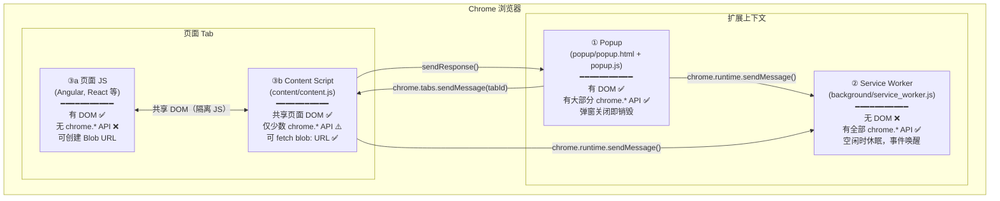
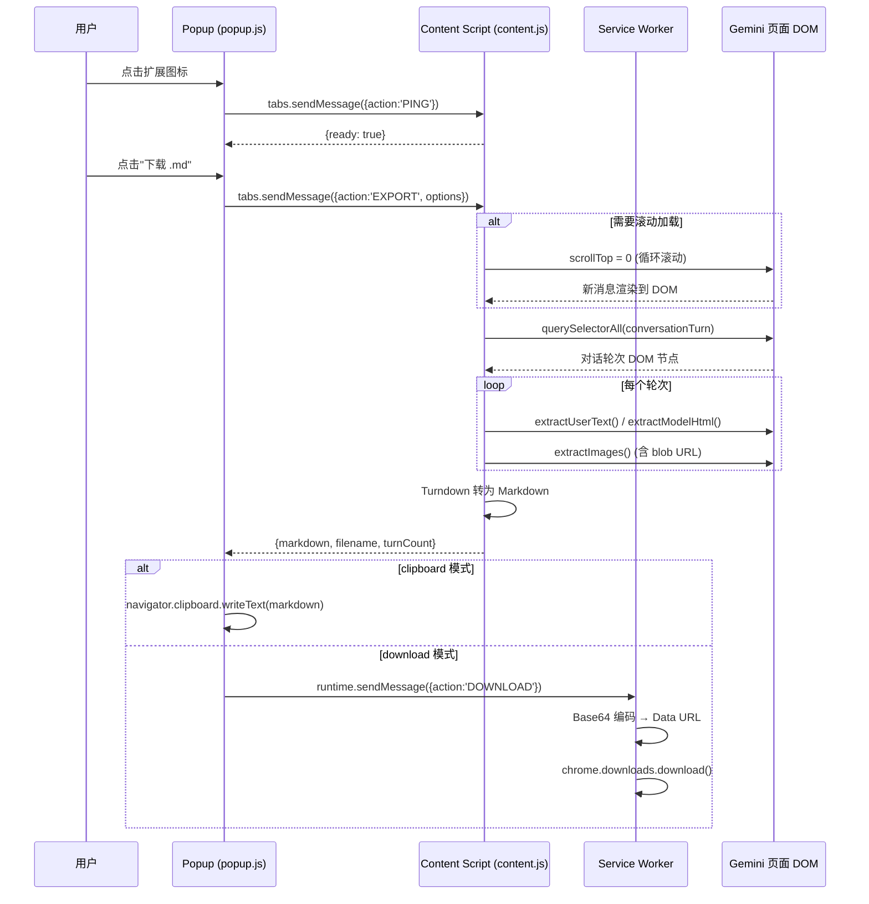

# Chrome Extension MV3 技术报告

> 基于 Gemini Chat Exporter 项目的实践分析，结合官方文档整理。

---

## 1. 架构总览：四个独立的 JS 上下文

Chrome Extension MV3 中存在**四个隔离的 JavaScript
执行环境**，它们通过消息系统通信：



### 1.1 各上下文能力矩阵

| 能力                             | Popup           | Service Worker   | Content Script  | 页面 JS       |
| -------------------------------- | --------------- | ---------------- | --------------- | ------------- |
| **DOM 访问**                     | ✅ 自己的 HTML  | ❌ 无 DOM        | ✅ 共享页面 DOM | ✅ 自己的 DOM |
| **`chrome.downloads`**           | ✅              | ✅               | ❌              | ❌            |
| **`chrome.storage`**             | ✅              | ✅               | ✅              | ❌            |
| **`chrome.runtime.sendMessage`** | ✅              | ✅               | ✅              | ❌            |
| **`chrome.tabs.sendMessage`**    | ✅              | ✅               | ❌              | ❌            |
| **`chrome.scripting`**           | ✅              | ✅               | ❌              | ❌            |
| **`fetch(blobUrl)`**             | ❌ 不同 origin  | ❌ 无 DOM 上下文 | ✅ 同 origin    | ✅ 自己创建的 |
| **`URL.createObjectURL`**        | ✅              | ❌               | ✅              | ✅            |
| **生命周期**                     | 弹窗开 → 关即死 | 空闲 30s 后休眠  | 随页面存活      | 随页面存活    |

> [!IMPORTANT]
> Content Script 可直接使用的 chrome API
> 非常有限，官方文档明确列出：`dom`、`i18n`、`storage`、`runtime.connect()`、`runtime.getManifest()`、`runtime.getURL()`、`runtime.id`、`runtime.onConnect`、`runtime.onMessage`、`runtime.sendMessage()`。其他
> API 必须通过消息间接调用。

**官方参考**:
[Content scripts — Understand content script capabilities](https://developer.chrome.com/docs/extensions/develop/concepts/content-scripts#capabilities)

---

## 2. Content Scripts 深度解析

### 2.1 Manifest 声明方式

```json
"content_scripts": [
  {
    "matches": ["https://gemini.google.com/*"],
    "js": [
      "lib/turndown.min.js",
      "lib/turndown-plugin-gfm.min.js",
      "content/content.js"
    ],
    "run_at": "document_idle"
  }
]
```

| 字段      | 含义                             | 本项目取值                       |
| --------- | -------------------------------- | -------------------------------- |
| `matches` | URL 匹配模式，定义在哪些页面注入 | 仅 Gemini 页面                   |
| `js`      | 按数组顺序依次注入的 JS 文件     | turndown 库在前，content.js 在后 |
| `run_at`  | 注入时机（见下方）               | `document_idle`                  |
| `css`     | 可选，注入的样式表               | 本项目未使用                     |
| `world`   | 执行环境，默认 `ISOLATED`        | 隔离世界（默认值）               |

### 2.2 `run_at` 三个时机与页面加载生命周期

```
浏览器导航到目标 URL
      │
      ▼
 ① HTML 开始解析
      │
      ├──── "document_start"
      │     • DOM 还是空的，<body> 都没有
      │     • 用途：最早拦截，注入 CSS 或 hook 原生 API
      │
      ▼
 ② DOM 解析完毕（DOMContentLoaded）
      │
      ├──── "document_end"
      │     • DOM 树完整，子资源（图片等）可能未加载
      │     • 等价于 document.readyState === "interactive"
      │
      ▼
 ③ 页面完全就绪或超时
      │
      └──── "document_idle"（默认值）
            • 在 window.onload 之后，或 document_end 后不久
            • 最安全：DOM 肯定就绪
            • Chrome 保证不会无限等待
```

> [!NOTE]
> 官方文档指出：在同一个 `run_at` 阶段内，manifest 中静态声明的 content scripts
> 优先于其他方式（动态注册、程序化注入）注入，且按 manifest 中声明顺序执行。

**官方参考**:
[Content scripts — Inject with static declarations](https://developer.chrome.com/docs/extensions/develop/concepts/content-scripts#static-declarative)

### 2.3 隔离世界 (Isolated World)

Content Script 运行在与页面 JS 隔离的环境中：

```
┌───────────────────────────────────────────────────┐
│  Gemini 页面 Tab                                   │
│                                                    │
│  ┌────────────────────┐  ┌─────────────────────┐  │
│  │  页面 JS 环境       │  │  隔离世界            │  │
│  │  (Angular, etc.)   │  │  (Content Script)    │  │
│  │                    │  │                      │  │
│  │  window.myVar ✅   │  │  window.myVar ❌     │  │
│  │  自定义全局变量 ✅  │  │  看不到页面全局 ❌    │  │
│  │                    │  │                      │  │
│  │       共享 ◄──── DOM ────► 共享               │  │
│  │                    │  │                      │  │
│  │  blob URL 创建 ✅  │──│─→ fetch blob URL ✅  │  │
│  └────────────────────┘  └─────────────────────┘  │
└───────────────────────────────────────────────────┘
```

**关键特性**：

- **JS 隔离**：两个环境有各自的全局作用域，互不可见
- **DOM 共享**：Content Script 可以完整读写页面 DOM（querySelector, appendChild
  等都正常工作）
- **DOM 属性隔离**：通过 JS 设置在 DOM 元素上的 **expando 属性**（如
  `button.myData = 123`）跨世界不共享，但 HTML attribute 共享
- **网络同源**：Content Script 与页面共享 origin，可以 fetch 页面创建的 `blob:`
  URL

**官方参考**:
[Content scripts — Work in isolated worlds](https://developer.chrome.com/docs/extensions/develop/concepts/content-scripts#isolated_world)

### 2.4 注入方式对比

| 方式           | 声明位置                                    | 适用场景                   |
| -------------- | ------------------------------------------- | -------------------------- |
| **静态声明**   | manifest.json `content_scripts`             | URL 模式确定，始终需要注入 |
| **动态注册**   | `chrome.scripting.registerContentScripts()` | URL 模式运行时确定         |
| **程序化注入** | `chrome.scripting.executeScript()`          | 按需一次性注入             |

本项目两种都用了：manifest 静态声明保证页面打开时自动注入，同时
[popup.js](https://github.com/congzhangzh/baize-chat-exporter/blob/main/popup/popup.js#L57-L65)
也有程序化注入作为 fallback。

---

## 3. 消息传递机制

### 3.1 两个发送 API 的本质区别

```
┌────────────────────────────────────────────────────────────┐
│                                                            │
│  chrome.runtime.sendMessage(msg)                           │
│  ─────────────────────────────                             │
│  发给"扩展内部"的所有 onMessage 监听者：                    │
│    • Service Worker ✅                                     │
│    • 当前打开的 Popup ✅                                   │
│    • Options Page ✅                                       │
│    • Content Script ❌（不会到达！）                        │
│                                                            │
├────────────────────────────────────────────────────────────┤
│                                                            │
│  chrome.tabs.sendMessage(tabId, msg)                       │
│  ────────────────────────────────                          │
│  发给"指定 Tab 中运行的 Content Script"：                  │
│    • 必须指定 tabId                                        │
│    • 只有 Popup / SW 可以调用（因为需要 tabs 权限）        │
│    • Content Script 自己不能调用                            │
│                                                            │
├────────────────────────────────────────────────────────────┤
│                                                            │
│  chrome.runtime.onMessage.addListener(callback)            │
│  ──────────────────────────────────────────────             │
│  统一的接收端：无论消息从哪来，都用这个 API 监听            │
│  Chrome 根据发送方式自动路由到正确的接收者                   │
│                                                            │
└────────────────────────────────────────────────────────────┘
```

### 3.2 本项目的完整通信链路

```
① Popup                   ② Content Script            ③ Service Worker
   │                            │                           │
   │── tabs.sendMessage ──►     │                           │
   │   {action:'PING'}          │                           │
   │                            │                           │
   │◄── sendResponse ─────      │                           │
   │   {ready: true}            │                           │
   │                            │                           │
   │── tabs.sendMessage ──►     │                           │
   │   {action:'EXPORT',...}    │                           │
   │                            │ (提取DOM, 滚动, 转MD)     │
   │◄── sendResponse ─────      │                           │
   │   {markdown, filename}     │                           │
   │                            │                           │
   │── runtime.sendMessage ─────────────────────────────►   │
   │   {action:'DOWNLOAD',      │                           │
   │    markdown, filename}     │               chrome.downloads.download()
```

### 3.3 异步响应的关键机制

```javascript
chrome.runtime.onMessage.addListener((message, sender, sendResponse) => {
    // 异步操作...
    someAsyncOperation().then((result) => {
        sendResponse(result); // 稍后回复
    });

    return true; // ← 关键！必须返回 true 保持消息通道开放
});
```

> [!WARNING]
> 如果监听器内有异步操作但不返回 `true`，消息通道会立即关闭，`sendResponse`
> 的调用将被忽略，发送方会收到 `undefined` 响应。从 Chrome 146 起，也支持返回
> Promise 作为异步响应方式。

**官方参考**:
[Message passing — Simple one-time requests](https://developer.chrome.com/docs/extensions/develop/concepts/messaging#simple)

### 3.4 设计反思：本项目中 Service Worker 的必要性

| 路径                                | 可行性          | 说明                                             |
| ----------------------------------- | --------------- | ------------------------------------------------ |
| Popup → SW → `chrome.downloads`     | ✅ 当前方案     | 绕了一圈，但可工作                               |
| Popup 直接调用 `chrome.downloads`   | ✅ **完全可行** | Popup 作为扩展页面，拥有 `chrome.downloads` 权限 |
| Content Script → `<a>` 下载         | ⚠️ 可行但不优雅 | 不走下载管理器                                   |
| Content Script → `chrome.downloads` | ❌ 不可行       | Content Script 没有这个 API                      |

> [!TIP]
> 本项目的 Service Worker 可以简化为空文件（MV3
> 要求必须声明但不要求有实际逻辑）。下载功能可以直接在 Popup 中完成。

---

## 4. Service Worker 生命周期

### 4.1 安装流程

```
用户安装/更新扩展
      │
      ▼
 ① install 事件（标准 SW 事件）
      │
      ▼
 ② chrome.runtime.onInstalled 事件
    • reason: "install" | "update" | "chrome_update"
    • 适合做一次性初始化（如创建 context menu）
      │
      ▼
 ③ activate 事件（立即触发，无需等待页面刷新）
```

### 4.2 休眠与唤醒

| 条件                            | 说明                                   |
| ------------------------------- | -------------------------------------- |
| **30 秒无活动** → 终止          | 接收事件或调用 chrome API 会重置计时器 |
| **单个请求 > 5 分钟** → 终止    | 处理时间过长的保护机制                 |
| **fetch() 响应 > 30 秒** → 终止 | 网络请求超时保护                       |
| **收到事件** → 唤醒             | 即使已休眠，新事件会自动唤醒 SW        |

> [!CAUTION]
> SW 终止后，所有**全局变量**都会丢失。持久化状态必须使用
> `chrome.storage`、IndexedDB 或 CacheStorage。

**官方参考**:
[The extension service worker lifecycle — Idle and shutdown](https://developer.chrome.com/docs/extensions/develop/concepts/service-workers/lifecycle)

---

## 5. Blob URL 深度解析

### 5.1 本质：纯内存引用

```
blob:https://gemini.google.com/3a4b5c6d-7e8f-9a0b-1c2d-3e4f5a6b7c8d
│      │                          │
│      │                          └── UUID（浏览器随机生成）
│      └── 创建者的 origin（仅用于同源策略，不是服务器地址）
└── 协议标识
```

| 属性               | 值                                                      |
| ------------------ | ------------------------------------------------------- |
| **存储位置**       | 浏览器进程内存（RAM）                                   |
| **与服务器的关系** | **完全无关**，`https://gemini.google.com` 仅标识 origin |
| **本地浏览器打开** | ✅ 同一浏览器可直接在地址栏粘贴打开                     |
| **跨标签页访问**   | ✅ 同 origin 下的其他 tab 可访问                        |
| **跨浏览器/外部**  | ❌ 完全不可用                                           |
| **持久性**         | ❌ 页面关闭/刷新后失效                                  |

### 5.2 生命周期

```
页面 JS 调用 URL.createObjectURL(blob)
      │
      ▼
 浏览器在内存中创建映射：UUID → Blob 数据
      │
      ├── Blob URL 保持有效（内存中）
      │   • 可被同 origin 的任何上下文 fetch
      │   • 可用作  src、<a> href 等
      │
      ├── 显式释放：URL.revokeObjectURL(url)
      │   → 映射被删除，URL 失效，内存可回收
      │
      └── 自动释放：创建它的 Document 被卸载（关闭/导航离开）
          → 浏览器自动释放所有该文档创建的 object URL
```

> [!NOTE]
> 每次调用 `URL.createObjectURL()` 都会创建一个**新的唯一 URL**，即使传入同一个
> Blob 对象。每个 URL 都需要单独 revoke。在 Service Worker 中
> `URL.revokeObjectURL()` 不可用。

**官方参考**:
[MDN — URL.createObjectURL()](https://developer.mozilla.org/en-US/docs/Web/API/URL/createObjectURL_static)

### 5.3 在 Chrome Extension 中处理 Blob URL

**场景**：Gemini 用户上传图片后，页面以 `blob:` URL
显示；导出时需要保存这些图片。

**可行方案**：Content Script 运行在与页面同 origin 的隔离世界中，可以
`fetch(blobUrl)` 获取图片数据：

```javascript
// Content Script 中（与页面同 origin，可访问 blob URL）
async function blobUrlToDataUrl(blobUrl) {
    const response = await fetch(blobUrl);
    const blob = await response.blob();
    return new Promise((resolve, reject) => {
        const reader = new FileReader();
        reader.onloadend = () => resolve(reader.result);
        reader.onerror = reject;
        reader.readAsDataURL(blob);
    });
}

// 使用：blob:https://gemini.google.com/xxx → data:image/png;base64,...
const dataUrl = await blobUrlToDataUrl("blob:https://gemini.google.com/xxx");
```

**各上下文的 Blob URL 访问能力**：

| 上下文         | 能否 fetch blob URL？ | 原因                                            |
| -------------- | --------------------- | ----------------------------------------------- |
| Content Script | ✅                    | 与页面共享 origin                               |
| 页面 JS        | ✅                    | 创建者本身                                      |
| Popup          | ❌                    | origin 是 `chrome-extension://xxx`，不同 origin |
| Service Worker | ❌                    | 无 DOM 上下文，且 origin 不同                   |

---

## 6. 本项目数据流完整图



---

## 7. 官方文档索引

| 主题                          | 链接                                                                                    |
| ----------------------------- | --------------------------------------------------------------------------------------- |
| **Content Scripts**           | https://developer.chrome.com/docs/extensions/develop/concepts/content-scripts           |
| **Message Passing**           | https://developer.chrome.com/docs/extensions/develop/concepts/messaging                 |
| **Service Worker Lifecycle**  | https://developer.chrome.com/docs/extensions/develop/concepts/service-workers/lifecycle |
| **Service Worker Basics**     | https://developer.chrome.com/docs/extensions/develop/concepts/service-workers/basics    |
| **Match Patterns**            | https://developer.chrome.com/docs/extensions/develop/concepts/match-patterns            |
| **Manifest V3 Overview**      | https://developer.chrome.com/docs/extensions/develop/migrate/what-is-mv3                |
| **chrome.downloads API**      | https://developer.chrome.com/docs/extensions/reference/api/downloads                    |
| **chrome.storage API**        | https://developer.chrome.com/docs/extensions/reference/api/storage                      |
| **chrome.scripting API**      | https://developer.chrome.com/docs/extensions/reference/api/scripting                    |
| **chrome.runtime API**        | https://developer.chrome.com/docs/extensions/reference/api/runtime                      |
| **Permissions List**          | https://developer.chrome.com/docs/extensions/reference/permissions-list                 |
| **Blob URL (MDN)**            | https://developer.mozilla.org/en-US/docs/Web/API/URL/createObjectURL_static             |
| **URL.revokeObjectURL (MDN)** | https://developer.mozilla.org/en-US/docs/Web/API/URL/revokeObjectURL_static             |

---

## 8. 改进建议

### 8.1 简化下载路径

当前下载路径：Popup → Service Worker → chrome.downloads，可以简化为 Popup
直接调用：

```diff
// popup.js
- chrome.runtime.sendMessage({
-   action: 'DOWNLOAD',
-   markdown: response.markdown,
-   filename: response.filename
- });
+ const bytes = new TextEncoder().encode(response.markdown);
+ const binary = Array.from(bytes, b => String.fromCharCode(b)).join('');
+ const dataUrl = `data:text/markdown;charset=utf-8;base64,${btoa(binary)}`;
+ chrome.downloads.download({ url: dataUrl, filename: response.filename });
```

### 8.2 增加 Blob URL 图片导出

在 Content Script 中增加 blob URL 检测和转换逻辑：

```javascript
// content.js — extractImages 增强
async function resolveBlobUrl(url) {
    if (!url.startsWith("blob:")) return url;
    try {
        const response = await fetch(url);
        const blob = await response.blob();
        return new Promise((resolve) => {
            const reader = new FileReader();
            reader.onloadend = () => resolve(reader.result);
            reader.onerror = () => resolve(url); // fallback
            reader.readAsDataURL(blob);
        });
    } catch {
        return url; // fallback to original
    }
}
```

### 8.3 考虑使用 Canvas 作为 Blob URL 降级方案

如果 `fetch(blobUrl)` 因 CORS 策略受限（理论上不应该，但作为防御性编程）：

```javascript
async function imgToDataUrl(imgElement) {
    const canvas = document.createElement("canvas");
    canvas.width = imgElement.naturalWidth;
    canvas.height = imgElement.naturalHeight;
    const ctx = canvas.getContext("2d");
    ctx.drawImage(imgElement, 0, 0);
    return canvas.toDataURL("image/png");
}
```

> [!WARNING]
> Canvas 方案受 taint 限制：如果 `` 的 src 是跨域的且没有 CORS
> 头，`canvas.toDataURL()` 会抛出 SecurityError。但对于 blob
> URL（同源），此限制不适用。
