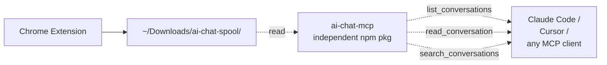

# Release Notes

> **汲百家所长，长出你自己的智慧** · *Draw from every AI; grow your own intelligence.*

## v2.0.0 — Multi-site AI Chat Exporter

The extension formerly known as **Gemini Chat Exporter** is now **AI Chat Exporter**, a per-site adapter framework supporting six sites out of the box.

### New sites

| Site | URL | Mode |
|------|-----|------|
| **ChatGPT** | `chatgpt.com` / `chat.openai.com` | turn-based |
| **Claude** | `claude.ai` | turn-based |
| **Meta AI** | `meta.ai` | turn-based |
| **WhatsApp Web** | `web.whatsapp.com` | **bubble-based** (new pipeline) |
| **OpenWebUI** | *user-supplied* | turn-based, runtime-injected |

Existing Gemini export behavior is unchanged.

### Architecture

- Split the monolithic `content/content.js` into an adapter registry + a generic framework + six per-site adapter files under `content/adapters/`.
- New **bubble-based** extraction pipeline for chat-app-style UIs (timestamps, per-message author, virtual-scroll harvesting).
- Markdown header / file naming / supported-site list all derive from the active adapter's `displayName` — no more hardcoded "Gemini".

### Per-site configuration

- New collapsible **"站点配置"** panel in the popup.
- Each adapter can be enabled / disabled.
- Each adapter accepts user-added **extra domains** (mirrors, internal deployments, OpenWebUI) — clicking "添加" triggers `chrome.permissions.request()` synchronously inside the user gesture; Chrome shows its native prompt.
- Removing an extra domain calls `chrome.permissions.remove()`.
- Bindings persist in `chrome.storage.local.site_bindings`.

### Quality improvements

- Multi-layer fallback selectors per adapter; `localStorage.AI_EXPORTER_DEBUG = '1'` enables match-level console diagnostics.
- ChatGPT: KaTeX `$...$` / `$$...$$` reconstruction, copy/like/dislike button stripping.
- Claude: Artifacts replaced with `[Artifact: title]` placeholders; "Extended Thinking" wrapped in collapsible `<details>` blocks.
- WhatsApp: timestamps parsed from `[data-pre-plain-text]`, role from `message-in` / `message-out`, virtual-scroll bubble harvesting with dedup by `data-id`.
- Active-site pill in the popup header now indicates which adapter (if any) matched the current tab.

### Spool bucket + MCP preview

- New optional **"同步写入 spool 桶"** checkbox in the popup. When enabled, every export additionally writes a `.md` copy to `~/Downloads/ai-chat-spool/{timestamp}-{adapter}-{title}.md` via Chrome's regular downloads API.
- This feeds a future independent MCP server (`ai-chat-mcp`, separate npm package, not yet shipped). See the Roadmap section below for the design sketch.
- Spool always stores plain inline-image Markdown for fulltext discoverability, even when the main export is a ZIP.

### Branding + sustainability

- Product slogan: **汲百家所长，长出你自己的智慧** · *Draw from every AI; grow your own intelligence.*
- Slogan reaches `manifest.json` description, popup header, README H1 and store Short Description.
- Sponsor footer in the popup (GitHub Sponsors + Ko-fi). Clicks open a real browser tab via `chrome.tabs.create()` to avoid popup auto-close edge cases.
- README adds a **"Sponsor a site"** section: sponsorship influences which adapter ships next, not what's accessible. All functionality remains free, license stays MIT, no paywalled build.

### Permissions / safety

- `host_permissions` widened to cover the six supported sites only.
- `optional_host_permissions: ["*://*/*"]` added but **never granted by default**; activates exclusively when the user explicitly adds a custom domain through the popup.
- Disabling an adapter in the popup makes the extension silently no-op on that domain even though manifest-declared `host_permissions` cannot be revoked at runtime.

---

## Known limitations (carryover into next milestones)

- **Meta AI selectors** are best-guess — no published reference exists; expect community-driven fallback refinement.
- **WhatsApp Web** uses a virtual scroller that recycles offscreen bubbles. Very long histories may miss the deepest bubbles; manually scrolling up first is a workaround.
- **Claude Artifacts** are placeholder-only; the artifact body lives in a side panel we don't traverse yet.
- **OpenWebUI** templates vary between v0.1 / 0.3 / 0.5+; fallbacks cover the common cases but you may need to file an issue with a DOM snippet for unusual variants.

---

## Roadmap

Philosophy: **token / attention is the bottleneck, not technical ability.** We deliberately ship adapters one at a time, each verified against real pages, instead of batching ten unverified ones. Scheduling is human-in-the-loop: sponsors and issue volume decide what comes next.

### Coming soon: more AI sites

Selector hints below are starting guesses for whoever picks up each adapter. Open an issue with a DOM snippet if you can speed things up — and tag it `sponsored-adapter` if you're sponsoring.

**Chinese ecosystem** (largest user bases first):

| Site | URL | Selector hint |
|------|-----|---------------|
| 豆包 Doubao | `doubao.com` | `[data-testid*="message"]`, `.receive-message` / `.send-message` |
| Kimi | `kimi.com`, `kimi.moonshot.cn` | `.chat-content`, role-based message blocks |
| 智谱清言 ChatGLM | `chatglm.cn` | `[data-message-id]`, `.user-msg` / `.bot-msg` |
| 通义千问 Qwen | `tongyi.aliyun.com`, `chat.qwen.ai` | `.qa-pair`, `.question` / `.answer` |
| 文心一言 Wenxin | `yiyan.baidu.com` | dialog-list custom elements |
| 讯飞星火 Spark | `xinghuo.xfyun.cn` | role-prefixed message divs |
| MiniMax 海螺 | `hailuoai.com` | message list with role distinction |
| 阶跃跃问 StepFun | `yuewen.cn` | TBD |
| 零一万物 01.AI | `wanzhi.lingyiwanwu.com` | TBD |

**English ecosystem**:

| Site | URL | Selector hint |
|------|-----|---------------|
| HuggingChat | `huggingface.co/chat` | `[role="article"]`, prose markdown blocks |
| Perplexity | `perplexity.ai` | `.prose`, source-cited answer cards |
| DeepSeek | `chat.deepseek.com` | similar to ChatGPT layout |
| Grok | `grok.com`, `x.com/i/grok` | TBD; X integration uses a different DOM tree |
| Mistral Le Chat | `chat.mistral.ai` | TBD |
| Microsoft Copilot | `copilot.microsoft.com` | shadow DOM challenges expected |
| Pi (Inflection) | `pi.ai` | streaming message bubbles |

Each adapter is ~100 lines of selector arrays plus optional cleanup hooks; the framework handles everything else (extraction pipeline, Turndown, image fetch, scroll-to-load).

### MCP server design sketch (separate npm package, not in v2.0)

The popup's optional "spool bucket" writes each export to:

```
~/Downloads/ai-chat-spool/{ISO_basic_timestamp}-{adapter_id}-{sanitized_title}.md
```

e.g. `20260512T152930-chatgpt-Transformer架构分析.md`. Filenames carry enough metadata for grep-style discovery without parsing the file body.

A separate **`ai-chat-mcp`** server (Node.js, distributed via npm — to be opened later as its own repo) reads that directory and offers three MCP tools:



- `list_conversations(adapter?, since?, limit?)` → metadata of recent exports
- `read_conversation(filename)` → full Markdown body
- `search_conversations(query, adapter?)` → fulltext search

Why the file-system bucket instead of native messaging?

1. **Zero coupling**: extension only writes files, MCP server only reads files. Either can be updated, replaced, or uninstalled without breaking the other.
2. **Chrome can't host a server**: MV3 service workers can't listen on a port.
3. **Native messaging requires platform-specific install scripts**: adds friction we don't need yet.
4. **Trivial debugging**: users can browse the spool directory themselves and see what the MCP server sees.

Open a GitHub issue if you want this prioritized; the MCP server work happens in a dedicated repo.

### Sponsor-driven scheduling

Funding tracks:

- [GitHub Sponsors](https://github.com/sponsors/congzhangzh) — recurring or one-time
- [Ko-fi](https://ko-fi.com/congzhangzh) — one-time, no account needed

Sponsorship influences scheduling, not features. The whole codebase stays MIT, no paywalled adapter, no premium build. The extension does not embed any payment UI; sponsor links in the popup just open a new browser tab.

### Next: Firefox support (followup, not in v2.0)

Tracked as a single follow-up task because it cuts across manifest, API surface, and UX:

- Split `manifest.json` per browser, OR add a build script that emits both `manifest.chrome.json` and `manifest.firefox.json`:
  - Chrome keeps `background.service_worker`
  - Firefox needs `background.scripts: ["background/service_worker.js"]`
- Vendor [webextension-polyfill](https://github.com/mozilla/webextension-polyfill) into `lib/` and switch source from `chrome.*` callbacks to `browser.*` promises (Firefox aliases `chrome` only for a subset of APIs).
- Add `browser_specific_settings.gecko.id` + `strict_min_version: "128.0"` for AMO submission.
- UX fallback: `chrome.permissions.request({origins: [...]})` does not pop a native dialog in Firefox the way it does in Chrome. The popup should detect Firefox via `navigator.userAgent` and, instead of trying to request the permission, show a copy-able instruction: "Open about:addons → AI Chat Exporter → Permissions and grant access to <pattern>".
- Cross-browser smoke test on each adapter.

Estimated incremental effort: ~20-30% on top of the v2.0 baseline.

### Other ideas (no commitment)

- ChatGPT / Claude conversation list iterator → bulk export multiple chats.
- Claude Artifact body retrieval (would require traversing the artifact side panel and stitching it back into the markdown).
- Markdown frontmatter (YAML) with metadata: model, timestamps, message count.
- Optional Obsidian Vault target instead of plain download.
- Spool-bucket viewer page (Chrome options page) for browsing exports directly inside the extension.

If you want any of these prioritized, please file an issue on GitHub.

---

## Migration from v1.x (Gemini Chat Exporter)

- Extension is renamed and re-versioned to 2.0.0; Chrome will surface this as an update.
- New permissions appear in Chrome's update notification dialog (the additional host permissions for ChatGPT / Claude / Meta AI / WhatsApp / OpenWebUI). Users must accept the update to keep using it.
- All previous preferences (auto-scroll, include images, ZIP, remote images) carry over; legacy `chrome.storage.local` keys are still read.
- A new `site_bindings` storage key is initialized on first launch with all six adapters enabled.
